# Déclencher un pipeline Microsoft Fabric à chaque nouvelle ligne insérée dans Azure SQL

*CDC, Eventstream et Activator, pas à pas : le guide pour réussir du premier coup*

Par Franck Mercier, novembre 2026

Une commande est enregistrée dans votre base Azure SQL et, quelques secondes plus tard, un pipeline Fabric la traite automatiquement, sans planification ni interrogation périodique. C'est exactement ce que permet la combinaison de trois briques de Microsoft Fabric Real-Time Intelligence : la capture des changements de données (CDC) côté SQL, un Eventstream qui transforme chaque changement en événement, et une règle Activator qui lance le pipeline.

J'ai monté cette chaîne de bout en bout et j'ai rencontré quelques pièges qui ne sont pas évidents à la lecture de la documentation. Ce guide les intègre tous : si vous suivez les étapes dans l'ordre, avec les valeurs indiquées, la solution doit fonctionner dès le premier essai. Une section de dépannage reprend en fin d'article les messages d'erreur exacts que j'ai obtenus et leur correctif.

## 1. Ce que vous allez construire

Le scénario est volontairement simple : une table `dbo.Commandes` reçoit des commandes. À chaque nouvelle commande (et uniquement aux insertions), un pipeline Fabric reçoit l'identifiant, le montant et le courriel de la commande, puis appelle une procédure stockée qui écrit une ligne de journal. Cette ligne de journal est la preuve tangible que toute la chaîne fonctionne.

Le parcours d'un événement est le suivant :

1. Une application exécute un INSERT dans `dbo.Commandes`.
2. Le CDC d'Azure SQL enregistre la nouvelle ligne dans sa table de changements.
3. Le connecteur Azure SQL DB (CDC) de l'Eventstream lit ce changement et le publie sous forme d'événement JSON au format Debezium.
4. L'Eventstream transmet l'événement à une destination Activator.
5. La règle Activator vérifie qu'il s'agit d'une insertion (champ op égal à c) et lance le pipeline `PL_TraiterCommande` avec trois paramètres.
6. Le pipeline appelle la procédure `dbo.usp_TraiterCommande`, qui écrit dans `dbo.JournalTraitement`.

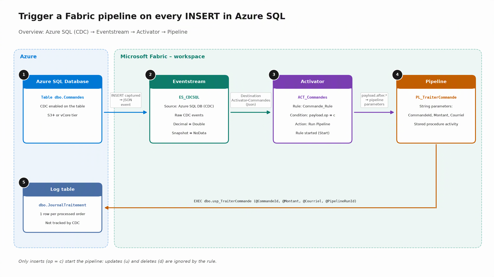

<!--  -->

Pour éviter toute ambiguïté, je vous recommande de réutiliser exactement les noms ci-dessous lors de votre premier essai. Les scripts et les expressions de l'article y font référence.

| Élément | Nom utilisé dans l'article |
|---|---|
| Serveur logique Azure SQL | `<votre-serveur>.database.windows.net` |
| Base de données | `<votre-base>` |
| Table surveillée par le CDC | `dbo.Commandes` |
| Table de journal (preuve d'exécution) | `dbo.JournalTraitement` |
| Procédure stockée | `dbo.usp_TraiterCommande` |
| Pipeline Fabric | `PL_TraiterCommande` |
| Eventstream | `ES_CDCSQL` |
| Destination Activator dans l'Eventstream | `Activator-Commandes` |
| Élément Activator | `ACT_Commandes` |
| Règle Activator | `Commande_Rule` |

## 2. Prérequis

Vérifiez chacun de ces points avant de commencer. Trois d'entre eux (niveau de service, authentification SQL et accès réseau) sont à l'origine de la majorité des échecs.

| Prérequis | Détail |
|---|---|
| Espace de travail Fabric | Sur une capacité Fabric (ou d'essai), avec le rôle Contributeur ou supérieur. Le pipeline, l'Eventstream et l'Activator seront créés dans cet espace. |
| Niveau de service Azure SQL | Standard S3 (100 DTU) ou supérieur, ou n'importe quel niveau vCore. Le CDC est refusé sur Free, Basic et Standard S0, S1, S2, ainsi que dans un pool élastique de moins de 100 eDTU ou de moins de 1 vCore. |
| Authentification SQL | Le connecteur CDC de l'Eventstream accepte uniquement l'authentification Basic (utilisateur et mot de passe SQL). L'option « Microsoft Entra-only authentication » du serveur doit donc être désactivée. |
| Accès réseau | La base doit être joignable depuis Fabric. Pour une démonstration : accès public activé et autorisation des services Azure. En production : injection de réseau virtuel du connecteur Eventstream. |
| Droits sur la base | Un compte membre de db_owner pour activer le CDC et créer les objets. |
| Mise en miroir | La mise en miroir Fabric ne doit pas être activée sur cette base (la documentation du connecteur CDC le demande explicitement). |

## 3. Étape 1 : vérifier le niveau de service de la base

Ouvrez votre base dans le portail Azure, puis Query editor, et exécutez :

```sql
SELECT DATABASEPROPERTYEX(DB_NAME(), 'Edition')          AS Edition,
       DATABASEPROPERTYEX(DB_NAME(), 'ServiceObjective') AS ServiceObjective;
```

Si le résultat est Basic, S0, S1 ou S2, augmentez le niveau avant d'aller plus loin : dans la base, ouvrez Settings > Compute + storage et choisissez Standard S3 ou un niveau vCore (General Purpose serverless convient très bien pour une démonstration). En ligne de commande :

```bash
az sql db update -g <votre-groupe-de-ressources> -s <votre-serveur> -n <votre-base> --service-objective S3
```

L'opération prend quelques minutes et la base reste en ligne. Si vous sautez cette étape, l'activation du CDC échoue avec ce message :

> Could not update the metadata that indicates database ... is enabled for Change Data Capture. ... The error returned was 22871: 'Change Data Capture is not supported on Free, Basic or Standard tier Single Database (S0,S1,S2) and Database in Elastic pool with max eDTUs < 100 or max vCore < 1. Please upgrade to a higher Service Objective.'

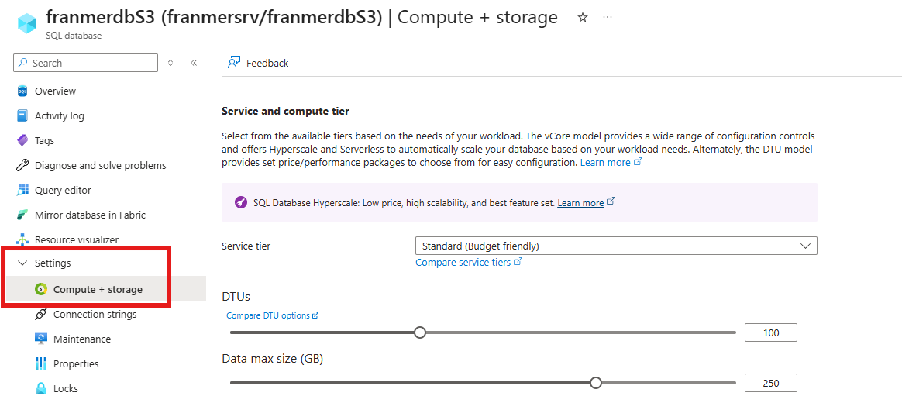


## 4. Étape 2 : préparer le réseau et l'authentification

Dans le portail Azure, ouvrez le serveur logique (et non la base) :

1. Settings > Microsoft Entra ID : vérifiez que la case « Support only Microsoft Entra authentication for this server » est décochée. Le connecteur CDC a besoin d'un utilisateur SQL.
2. Security > Networking : réglez Public network access sur Selected networks et cochez « Allow Azure services and resources to access this server ». Enregistrez.
3. Notez le nom complet du serveur (`<votre-serveur>.database.windows.net`), le nom de la base, ainsi que l'utilisateur et le mot de passe SQL que vous utiliserez dans l'Eventstream. Pour une démonstration, le compte administrateur SQL du serveur convient. En production, utilisez un compte dédié.

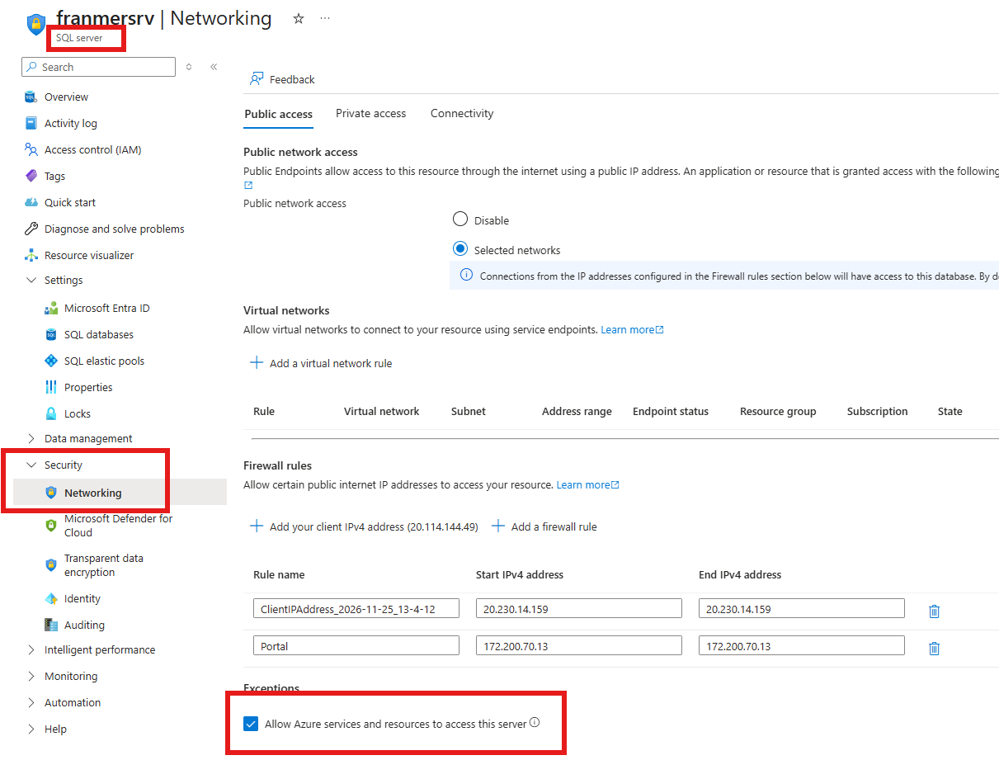

<!--  -->

## 5. Étape 3 : créer les objets SQL

Connecté à votre base (Query editor du portail, SSMS ou VS Code), exécutez le script complet ci-dessous. Il crée la table surveillée, la table de journal et la procédure appelée par le pipeline.

```sql
-- 1. Table source, surveillée par le CDC
DROP TABLE IF EXISTS dbo.Commandes;
GO
CREATE TABLE dbo.Commandes (
    CommandeId    INT IDENTITY(1,1) NOT NULL CONSTRAINT PK_Commandes PRIMARY KEY,
    ClientId      INT               NOT NULL,
    NomClient     NVARCHAR(100)     NOT NULL,
    Courriel      NVARCHAR(200)     NULL,
    Produit       NVARCHAR(100)     NOT NULL,
    Quantite      INT               NOT NULL CONSTRAINT CK_Commandes_Quantite CHECK (Quantite > 0),
    PrixUnitaire  DECIMAL(10,2)     NOT NULL,
    Montant       DECIMAL(12,2)     NOT NULL,   -- colonne normale, PAS une colonne calculée
    Statut        NVARCHAR(20)      NOT NULL CONSTRAINT DF_Commandes_Statut DEFAULT N'Nouvelle',
    Ville         NVARCHAR(50)      NULL,
    DateCommande  DATETIME2(3)      NOT NULL CONSTRAINT DF_Commandes_Date DEFAULT SYSUTCDATETIME()
);
GO

-- 2. Table de journal, alimentée par le pipeline (NON surveillée par le CDC)
DROP TABLE IF EXISTS dbo.JournalTraitement;
GO
CREATE TABLE dbo.JournalTraitement (
    JournalId      INT IDENTITY(1,1) NOT NULL CONSTRAINT PK_JournalTraitement PRIMARY KEY,
    CommandeId     INT               NOT NULL,
    Montant        NVARCHAR(50)      NULL,
    Courriel       NVARCHAR(200)     NULL,
    PipelineRunId  NVARCHAR(100)     NULL,
    DateTraitement DATETIME2(3)      NOT NULL CONSTRAINT DF_Journal_Date DEFAULT SYSUTCDATETIME()
);
GO

-- 3. Procédure appelée par le pipeline
CREATE OR ALTER PROCEDURE dbo.usp_TraiterCommande
    @CommandeId    INT,
    @Montant       NVARCHAR(50),
    @Courriel      NVARCHAR(200),
    @PipelineRunId NVARCHAR(100)
AS
BEGIN
    SET NOCOUNT ON;
    INSERT INTO dbo.JournalTraitement (CommandeId, Montant, Courriel, PipelineRunId)
    VALUES (@CommandeId, @Montant, @Courriel, @PipelineRunId);
END;
GO
```

Deux choix de conception sont importants ici. D'abord, Montant est une colonne ordinaire, alimentée par l'INSERT. Le CDC de SQL Server ne capture pas la valeur des colonnes calculées, même persistées : elles arriveraient toujours à NULL dans l'événement. Ensuite, la table de journal n'est pas surveillée par le CDC, ce qui évite qu'une écriture du pipeline ne redéclenche le pipeline.

## 6. Étape 4 : activer le CDC sur la base et sur la table

```sql
-- Activer le CDC sur la base
EXEC sys.sp_cdc_enable_db;
GO

-- Activer le CDC sur la table dbo.Commandes uniquement
EXEC sys.sp_cdc_enable_table
     @source_schema = N'dbo',
     @source_name   = N'Commandes',
     @role_name     = NULL;
GO

-- Vérification
SELECT name, is_cdc_enabled    FROM sys.databases WHERE name = DB_NAME();
SELECT name, is_tracked_by_cdc FROM sys.tables    WHERE name IN (N'Commandes', N'JournalTraitement');
```

Résultat attendu : `is_cdc_enabled` vaut 1 pour la base, `is_tracked_by_cdc` vaut 1 pour Commandes et 0 pour JournalTraitement.

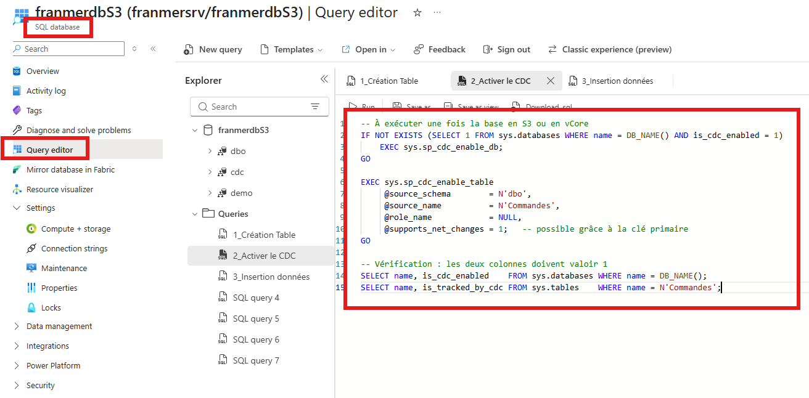

<!--  -->

## 7. Étape 5 : créer le pipeline Fabric

Le pipeline doit exister avant la règle Activator, puisque la règle le sélectionne et lit ses paramètres.

### 7.1 Créer le pipeline et ses paramètres

1. Dans votre espace de travail Fabric, sélectionnez + New item, puis Pipeline. Nommez-le `PL_TraiterCommande`.
2. Cliquez sur une zone vide du canevas, ouvrez l'onglet Parameters en bas de l'écran, puis ajoutez trois paramètres avec + New :

   | Nom (respecter la casse) | Type | Valeur par défaut |
   |---|---|---|
   | CommandeId | String | (vide) |
   | Montant | String | (vide) |
   | Courriel | String | (vide) |

Pourquoi tout en String ? C'est le choix le plus robuste : l'Activator transmet alors des valeurs texte, sans aucune ambiguïté de type entre Activator et pipeline. La conversion en entier est faite plus loin, au moment de l'appel de la procédure stockée.

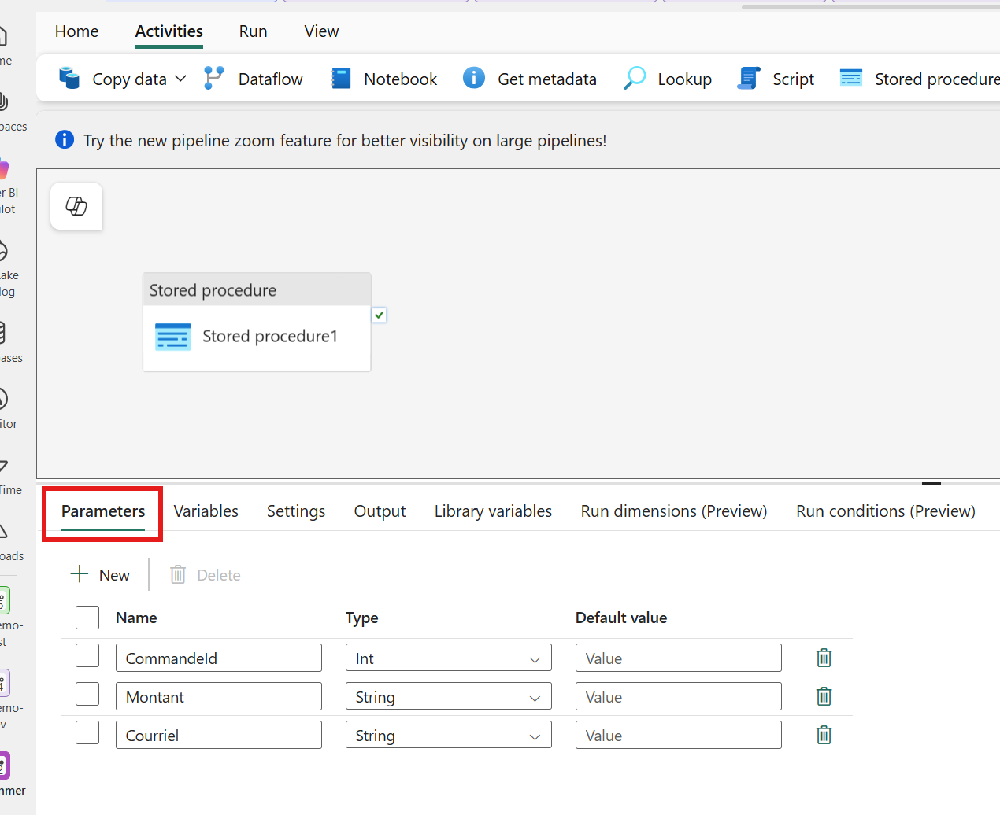

<!--  -->

### 7.2 Ajouter l'activité Procédure stockée

1. Dans l'onglet Activities, ajoutez une activité Stored procedure sur le canevas.
2. Dans son onglet Settings, choisissez la connexion à votre base Azure SQL (ou créez-la avec le serveur et la base notés à l'étape 2).
3. Dans Stored procedure name, sélectionnez `dbo.usp_TraiterCommande`.
4. Sous Stored procedure parameters, cliquez sur Import pour récupérer les quatre paramètres de la procédure (sinon, ajoutez-les avec + New).
5. Pour chaque paramètre, cliquez dans le champ Value, choisissez Add dynamic content, collez l'expression du tableau ci-dessous, puis validez avec OK.

   | Name | Type | Value (contenu dynamique) |
   |---|---|---|
   | CommandeId | Int32 | `@pipeline().parameters.CommandeId` |
   | Montant | String | `@pipeline().parameters.Montant` |
   | Courriel | String | `@pipeline().parameters.Courriel` |
   | PipelineRunId | String | `@pipeline().RunId` |

6. Enregistrez le pipeline (Save).

Pourquoi une procédure stockée plutôt qu'une activité Script ? Dans l'éditeur de l'activité Script, le caractère @ d'une variable T-SQL (par exemple `@CommandeId`) est interprété comme le début d'une expression Fabric. On obtient alors des erreurs déroutantes comme « Must declare the scalar variable "@CommandeId" ». L'activité Stored procedure évite complètement ce piège, et transmet les valeurs comme de vrais paramètres SQL, ce qui protège aussi contre l'injection SQL.

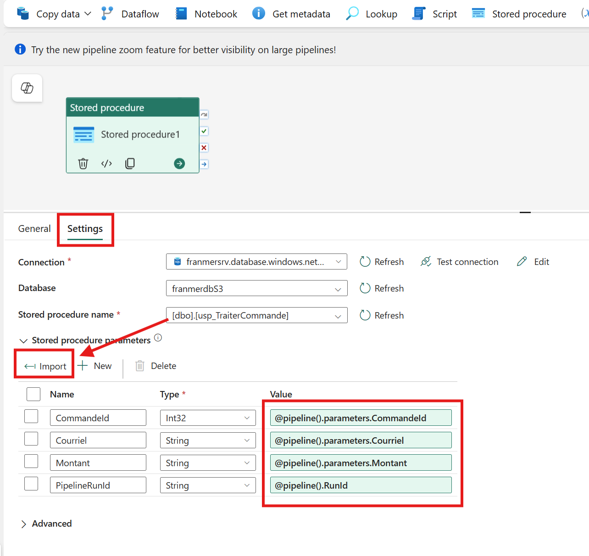


### 7.3 Tester le pipeline seul (recommandé)

Avant de brancher l'Activator, validez le pipeline isolément : cliquez sur Run, saisissez CommandeId = 1, Montant = 10.0 et Courriel = test@exemple.com, puis lancez. Vérifiez ensuite dans la base :

```sql
SELECT * FROM dbo.JournalTraitement ORDER BY JournalId DESC;
```

Une ligne doit apparaître. Si ce test échoue, corrigez le pipeline maintenant : il est beaucoup plus simple de diagnostiquer un pipeline seul que la chaîne complète. Vous pouvez ensuite vider la table de journal avec `DELETE FROM dbo.JournalTraitement;`.

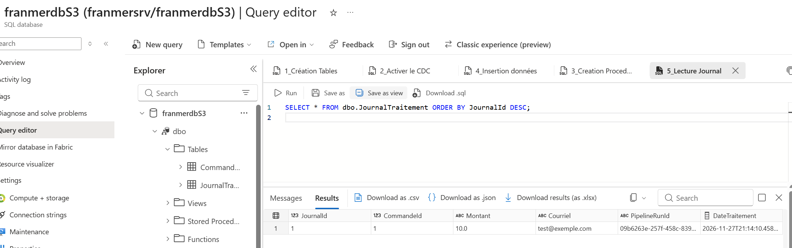

## 8. Étape 6 : créer l'Eventstream et la source CDC

### 8.1 Créer l'Eventstream

Dans l'espace de travail, sélectionnez + New item, puis Eventstream. Nommez-le `ES_CDCSQL` et créez-le.

### 8.2 Ajouter la source Azure SQL DB (CDC)

1. Sélectionnez Connect data sources (ou Add source > Connect data sources dans le ruban).
2. Recherchez la tuile Azure SQL DB (CDC) et cliquez sur Connect.
3. Sélectionnez New connection et renseignez :

   | Champ | Valeur |
   |---|---|
   | Server | `<votre-serveur>.database.windows.net` |
   | Database | `<votre-base>` |
   | Connection name | Un nom explicite, par exemple `cnx-sql-cdc-commandes` |
   | Authentication kind | Basic (seule option prise en charge par ce connecteur) |
   | Username / Password | L'utilisateur et le mot de passe SQL notés à l'étape 2 |

4. Cliquez sur Connect.


### 8.3 Choisir la table et les paramètres avancés

1. Sélectionnez Enter table name(s) et saisissez `dbo.Commandes`. N'utilisez pas All tables : vous captureriez aussi la table de journal.
2. Dépliez Advanced settings et réglez ces deux options. Laissez les autres à leur valeur par défaut.

   | Paramètre avancé | Valeur à choisir | Pourquoi |
   |---|---|---|
   | Decimal handling mode | Double | En mode Precise (par défaut), les colonnes DECIMAL sont encodées en octets dans l'événement et deviennent illisibles pour l'Activator et le pipeline. |
   | Snapshot mode | NoData | Seules les insertions faites après le démarrage du connecteur sont envoyées. Avec Initial, toutes les lignes déjà présentes seraient émises au démarrage. |

3. Laissez le nom de source proposé (par exemple `azure-sql-db`) et cliquez sur Next.


### 8.4 Gestion du schéma : choisir Raw CDC events

Sur la page Schema handling, sélectionnez Raw CDC events et laissez décochée la case « Register raw CDC events schema to Event schema set ». Cliquez sur Next, puis Add sur la page Review + connect.

Ne choisissez pas l'option « Analytics-ready events & auto-updated schema » (DeltaFlow), même si elle est marquée Recommended. Selon la documentation, seules les destinations Eventhouse, point de terminaison personnalisé et flux dérivé fonctionnent actuellement avec un Eventstream associé à des schémas. L'Activator n'en fait pas partie. DeltaFlow est excellent pour alimenter un Eventhouse, mais ce n'est pas notre objectif ici.


## 9. Étape 7 : ajouter la destination Activator et publier

1. Toujours en mode Edit, cliquez sur le + à droite du nœud de flux `ES_CDCSQL-stream` et choisissez Activator.
2. Renseignez le volet de destination :

   | Champ | Valeur |
   |---|---|
   | Destination name | `Activator-Commandes` |
   | Workspace | Votre espace de travail |
   | Activator | Create new, puis nommez-le `ACT_Commandes` |
   | Input data format | Json |

3. Cliquez sur Save, puis sur Publish en haut à droite.

La destination est branchée directement sur le flux : pas besoin d'opérateur de transformation, le filtrage des insertions se fera dans la règle Activator. Le volet affiche aussi un avertissement : l'Activator accepte des événements de 256 Ko au maximum. Avec une table comme `dbo.Commandes`, on en est très loin.

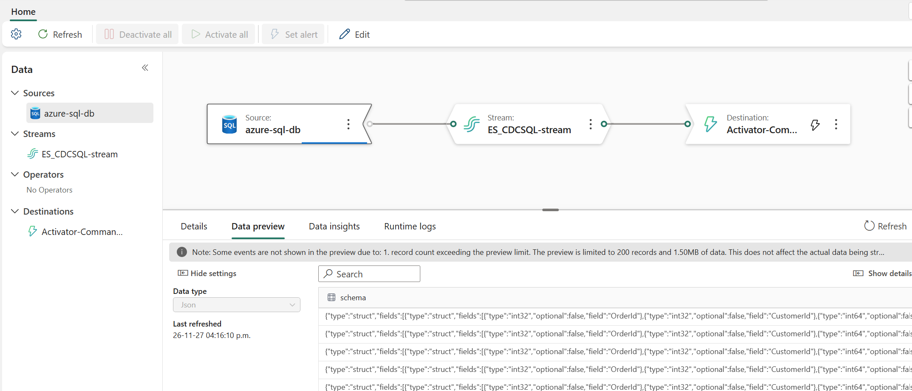


## 10. Étape 8 : envoyer un premier événement et comprendre son format

Cette étape est indispensable. L'Activator ne propose les propriétés d'un événement (`payload.op`, `payload.after.CommandeId`, etc.) qu'après en avoir reçu au moins un. Insérez donc une première commande, qui servira d'amorce :

```sql
INSERT INTO dbo.Commandes (ClientId, NomClient, Courriel, Produit, Quantite, PrixUnitaire, Montant, Ville)
OUTPUT inserted.CommandeId
VALUES (100, N'Client amorce', N'vous@exemple.com', N'Formation Power BI', 2, 450.00, 900.00, N'Montréal');
```

Comptez en général de quelques secondes à une minute : le CDC lit le journal de transactions à intervalle régulier, puis le connecteur publie l'événement. Dans l'Eventstream, passez en vue Live, sélectionnez le nœud `ES_CDCSQL-stream` et ouvrez l'onglet Data preview.

Vous verrez un événement au format Debezium. En voici une version simplifiée (vos valeurs seront différentes) :

```json
{
  "schema": { "...": "description technique des champs" },
  "payload": {
    "before": null,
    "after": {
      "CommandeId": 1,
      "ClientId": 100,
      "NomClient": "Client amorce",
      "Courriel": "vous@exemple.com",
      "Produit": "Formation Power BI",
      "Quantite": 2,
      "PrixUnitaire": 450.0,
      "Montant": 900.0,
      "Statut": "Nouvelle",
      "Ville": "Montréal",
      "DateCommande": 1795705600000
    },
    "source": { "connector": "sqlserver", "schema": "dbo", "table": "Commandes" },
    "op": "c",
    "ts_ms": 1795705601234
  }
}
```

Deux champs nous intéressent. `payload.after` contient les colonnes de la ligne après le changement. `payload.op` indique le type d'opération :

| Valeur de `payload.op` | Signification | Doit lancer le pipeline ? |
|---|---|---|
| c | Insertion (create) | Oui |
| u | Mise à jour (update) | Non |
| d | Suppression (delete) ; `payload.after` est alors vide | Non |
| r | Lecture lors de l'instantané initial (read) | Non |

Vous pouvez aussi confirmer côté SQL que le CDC a bien capté la ligne :

```sql
SELECT TOP (10) __$start_lsn, __$operation, CommandeId, NomClient, Montant
FROM cdc.dbo_Commandes_CT
ORDER BY __$start_lsn DESC;   -- __$operation = 2 pour une insertion
```

> 📸 **CAPTURE D'ÉCRAN 12 : Data preview de l'Eventstream montrant `payload.op` = "c" et `payload.after`**

<!--  -->

## 11. Étape 9 : créer la règle Activator

### 11.1 Ouvrir le volet de création de règle

Dans l'Eventstream en vue Live, sélectionnez l'icône d'alerte (éclair) sur la destination `Activator-Commandes`. Dans le volet Rules, cliquez sur Add rule. Vous pouvez aussi ouvrir l'élément `ACT_Commandes` depuis l'espace de travail et créer la règle sur le flux `ES_CDCSQL-stream`.

### 11.2 Définir la condition : uniquement les insertions

1. Nommez la règle `Commande_Rule`.
2. Dans Condition > Condition 1, réglez :
Operation : Is equal to (groupe Text state), à la place de On every value ;
Column : `payload.op` ;
Value : c, tapé au clavier (c'est une valeur fixe) ;
Default type : laissez None.
N'utilisez pas Text change > Changes to : cette condition ne se déclenche que lorsque la valeur change. Deux insertions consécutives (c puis c) ne lanceraient le pipeline qu'une seule fois.

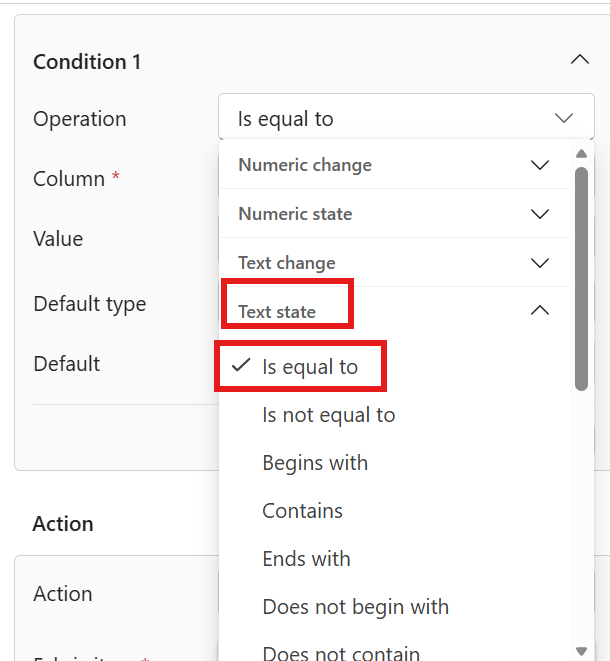

> 💡 **Pourquoi `payload.op` = `c` ?**
>
> Chaque événement émis par le connecteur CDC décrit un changement dans la table : `payload.before` contient la ligne avant le changement, `payload.after` la ligne après, et `payload.op` le **type d'opération** SQL qui l'a produit : `c` pour une insertion (*create*), `u` pour une mise à jour (*update*), `d` pour une suppression (*delete*) et `r` pour une lecture lors de l'instantané initial (*read*) (voir le tableau de la section 10).
>
> Sans condition, la règle lancerait le pipeline pour **chaque** événement du flux : une commande modifiée ou supprimée déclencherait aussi un traitement. En filtrant sur `payload.op` = `c`, seul un `INSERT` lance le pipeline. C'est aussi le seul cas où `payload.after` contient une nouvelle commande complète, ce qui garantit que `CommandeId`, `Montant` et `Courriel` sont bien renseignés.
>
> Côté SQL, c'est la même information que la colonne `__$operation` de la table `cdc.dbo_Commandes_CT`, où la valeur `2` correspond à une insertion.


### 11.3 Définir l'action : lancer le pipeline avec les bons paramètres

1. Dans Action > Select action, choisissez Run Pipeline.
2. Dans Fabric item, sélectionnez `PL_TraiterCommande`.
3. Cliquez trois fois sur Add parameter et renseignez :

   | Name (identique au pipeline, casse comprise) | Type | Value (sélectionnée avec l'icône étiquette) |
   |---|---|---|
   | CommandeId | String | `payload.after.CommandeId` |
   | Montant | String | `payload.after.Montant` |
   | Courriel | String | `payload.after.Courriel` |

Le point le plus important se trouve ici. La valeur doit être sélectionnée, pas tapée. Cliquez sur l'icône en forme d'étiquette à droite du champ Value, puis choisissez la propriété dans la liste. Elle apparaît alors sous forme de pastille (jeton). Si vous tapez `@CommandeId` au clavier, l'Activator envoie le texte littéral « `@CommandeId` » au pipeline, qui échoue. Vérifiez aussi qu'aucun caractère (un @ résiduel, un espace) ne reste devant ou derrière la pastille.

4. Dans Save location, conservez l'Activator `ACT_Commandes`, puis cliquez sur Create.

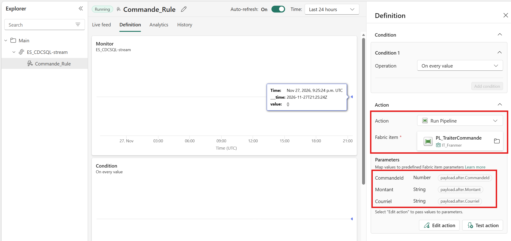


### 11.4 Démarrer la règle

Ouvrez la règle dans l'Activator et regardez le ruban : si le bouton Start est actif et Stop grisé, la règle est arrêtée. Cliquez sur Start. Faites ce contrôle après chaque modification de la règle : en pratique, une règle modifiée peut se retrouver arrêtée.


<!--  -->

## 12. Étape 10 : tester de bout en bout

### 12.1 Une insertion unique

```sql
INSERT INTO dbo.Commandes (ClientId, NomClient, Courriel, Produit, Quantite, PrixUnitaire, Montant, Ville)
OUTPUT inserted.CommandeId, inserted.Montant
VALUES (301, N'Test Activator', N'vous@exemple.com', N'Licence Fabric F64', 1, 8500.00, 8500.00, N'Québec');
```

Notez le CommandeId renvoyé par OUTPUT : vous le retrouverez dans les paramètres d'entrée du pipeline.

### 12.2 Une petite série d'insertions espacées

```sql
DECLARE @i INT = 1, @nb INT = 3;          -- 1 insertion = 1 exécution du pipeline
DECLARE @qte INT, @prix DECIMAL(10,2), @p INT, @v INT;

WHILE @i <= @nb
BEGIN
    -- Valeurs aléatoires calculées AVANT l'INSERT (évite les NULL de CHOOSE + NEWID)
    SET @qte  = 1 + ABS(CHECKSUM(NEWID())) % 10;
    SET @prix = CAST(100 + ABS(CHECKSUM(NEWID())) % 900 AS DECIMAL(10,2));
    SET @p    = 1 + ABS(CHECKSUM(NEWID())) % 3;
    SET @v    = 1 + ABS(CHECKSUM(NEWID())) % 4;

    INSERT INTO dbo.Commandes (ClientId, NomClient, Courriel, Produit, Quantite, PrixUnitaire, Montant, Ville)
    OUTPUT inserted.CommandeId, inserted.Produit, inserted.Montant
    VALUES (400 + @i,
            CONCAT(N'Client démo ', @i),
            N'vous@exemple.com',
            CHOOSE(@p, N'Licence Fabric F64', N'Formation Power BI', N'Capteurs IoT'),
            @qte, @prix, @qte * @prix,
            CHOOSE(@v, N'Montréal', N'Québec', N'Gatineau', N'Laval'));

    WAITFOR DELAY '00:00:10';             -- 10 secondes entre deux insertions
    SET @i += 1;
END;
```

### 12.3 Le test négatif : une mise à jour ne doit rien déclencher

```sql
UPDATE dbo.Commandes SET Statut = N'Expédiée' WHERE CommandeId = 1;
```

L'événement apparaît bien dans l'Eventstream avec `payload.op` égal à u, mais la règle ne s'active pas et aucune exécution du pipeline n'est lancée.

### 12.4 Où vérifier

| Étape | Où regarder | Ce que vous devez voir |
|---|---|---|
| Base | Requête sur `cdc.dbo_Commandes_CT` | Une ligne `__$operation` = 2 par commande insérée |
| Eventstream | Data preview du flux `ES_CDCSQL-stream` | Un événement par commande, avec `payload.op` = c |
| Activator | Historique d'activation de `Commande_Rule` | Une activation par insertion, aucune pour la mise à jour |
| Pipeline | Monitoring hub de Fabric | Une exécution réussie de `PL_TraiterCommande` par insertion ; dans ses paramètres d'entrée, CommandeId contient un vrai numéro (par exemple 2), jamais le texte « `@CommandeId` » |
| Journal | Requête ci-dessous | Une ligne de journal par commande insérée après le démarrage de la règle |

```sql
SELECT c.CommandeId, c.Montant, j.PipelineRunId, j.DateTraitement
FROM dbo.Commandes AS c
LEFT JOIN dbo.JournalTraitement AS j ON j.CommandeId = c.CommandeId
ORDER BY c.CommandeId DESC;
```

La commande d'amorce de l'étape 8 n'a pas de ligne de journal : elle a été insérée avant la création de la règle. C'est attendu.

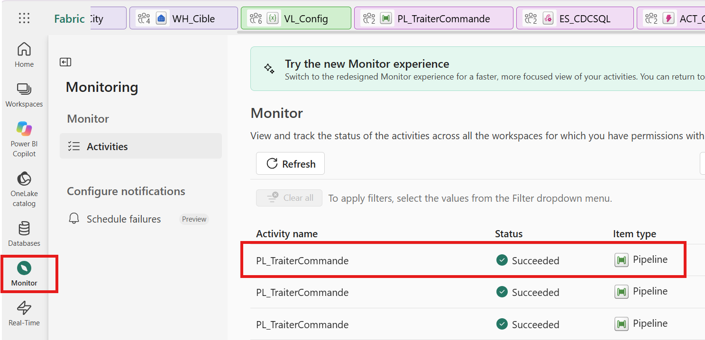

## 13. Récapitulatif des réglages clés

| Où | Réglage | Valeur |
|---|---|---|
| Azure SQL | Niveau de service | S3 ou plus, ou vCore |
| Azure SQL | Colonne Montant | Colonne ordinaire (pas calculée) |
| Source CDC | Authentication kind | Basic |
| Source CDC | Tables | `dbo.Commandes` |
| Source CDC | Decimal handling mode | Double |
| Source CDC | Snapshot mode | NoData |
| Source CDC | Schema handling | Raw CDC events, case d'enregistrement du schéma décochée |
| Destination | Type et format | Activator, Json, branchée directement sur le flux |
| Règle | Condition | `payload.op` Is equal to c |
| Règle | Action | Run Pipeline, `PL_TraiterCommande` |
| Règle | Valeurs des paramètres | Sélectionnées avec l'icône étiquette, type String |
| Règle | État | Démarrée (Start) |
| Pipeline | Paramètres | CommandeId, Montant, Courriel en String |
| Pipeline | Activité | Stored procedure, CommandeId converti en Int32 |

## 14. Dépannage : les erreurs que j'ai rencontrées

| Symptôme ou message | Cause | Correctif |
|---|---|---|
| Erreur 22871 : « Change Data Capture is not supported on Free, Basic or Standard tier Single Database (S0,S1,S2)... » | Niveau de service trop bas | Passer en S3 ou en vCore (étape 1), puis relancer le script d'activation |
| La connexion de la source CDC échoue | Base non joignable, ou authentification SQL désactivée | Autoriser l'accès des services Azure et décocher « Microsoft Entra-only authentication » (étape 2) |
| Aucun événement dans Data preview | CDC non activé sur la table, mauvais nom de table, ou aucune insertion depuis le démarrage (mode NoData) | Vérifier `is_tracked_by_cdc`, la liste de tables, puis insérer une nouvelle ligne et patienter jusqu'à une minute |
| Montant vaut toujours null dans l'événement | Montant est une colonne calculée | Le CDC ne capture pas les colonnes calculées : utiliser une colonne ordinaire |
| Montant apparaît sous forme de chaîne encodée illisible | Decimal handling mode resté à Precise | Le régler sur Double dans les paramètres avancés de la source |
| Impossible d'ajouter ou d'utiliser la destination Activator | Schéma associé à l'Eventstream (DeltaFlow ou case d'enregistrement cochée) | Recréer la source en Raw CDC events, case décochée |
| Pipeline en échec : « Must declare the scalar variable "@CommandeId" » | Le texte « `@CommandeId` » a été transmis au lieu de la valeur, ou une activité Script interprète le @ | Sélectionner la valeur avec l'icône étiquette dans la règle ; utiliser une activité Stored procedure |
| Pipeline en échec : « `@CommandeId` is not a valid value for Int32 » | La valeur du paramètre a été tapée au clavier dans la règle, ou un @ résiduel précède la pastille | Effacer le champ Value et resélectionner la propriété avec l'icône étiquette |
| Le pipeline se lance aussi pour les mises à jour ou les lignes existantes | La règle se déclenche sur chaque événement | Ajouter la condition `payload.op` Is equal to c ; utiliser Snapshot mode = NoData |
| Rerun échoue toujours avec la même erreur | Rerun réutilise exactement les mêmes paramètres d'entrée | Tester avec une nouvelle insertion après correction |
| La règle ne se déclenche plus après une modification | Règle arrêtée | Cliquer sur Start dans le ruban de l'Activator |

## 15. Avant de passer en production

Chaque insertion déclenche une exécution du pipeline. C'est idéal pour un traitement unitaire (notification, appel d'API, enrichissement d'une commande), mais à fort volume cela multiplie les exécutions et la consommation de capacité. Dans ce cas, restreignez la condition de la règle (par exemple un montant minimal) ou faites traiter au pipeline toutes les lignes en attente d'un coup plutôt qu'une seule.

Concevez le traitement pour qu'il soit idempotent : s'il est rejoué pour la même commande, il ne doit pas produire de doublon. Une contrainte d'unicité sur `JournalTraitement.CommandeId`, ou un MERGE dans la procédure, suffit dans ce scénario.

Côté sécurité, le connecteur CDC impose aujourd'hui l'authentification Basic. Utilisez un compte SQL dédié, avec un mot de passe robuste conservé dans un coffre et renouvelé régulièrement, et préférez l'injection de réseau virtuel du connecteur à un accès public. Si l'authentification Microsoft Entra est une exigence, surveillez Change Event Streaming (CES), en préversion pour SQL Server 2025 et Azure SQL Database : la base pousse elle-même ses changements vers un point de terminaison personnalisé de l'Eventstream, avec Microsoft Entra, un jeton SAS ou une clé SAS.

Enfin, gardez en tête que le CDC fixe un plancher de coût (S3 ou vCore) et que la mise en miroir Fabric ne doit pas être activée sur une base utilisée comme source CDC de l'Eventstream.

## 16. Nettoyage après la démonstration

Avant de redescendre la base sous S3, désactivez le CDC :

```sql
EXEC sys.sp_cdc_disable_table @source_schema = N'dbo', @source_name = N'Commandes', @capture_instance = 'all';
EXEC sys.sp_cdc_disable_db;
```

Supprimez ensuite, dans Fabric, la règle, l'élément `ACT_Commandes`, l'Eventstream `ES_CDCSQL` et le pipeline `PL_TraiterCommande`, puis réduisez le niveau de service de la base si vous le souhaitez.

## 17. Références

- [Ajouter une source Azure SQL Database CDC à un Eventstream](https://learn.microsoft.com/en-us/fabric/real-time-intelligence/event-streams/add-source-azure-sql-database-change-data-capture)
- [Ajouter une destination Activator à un Eventstream](https://learn.microsoft.com/en-us/fabric/real-time-intelligence/event-streams/add-destination-activator)
- [Créer une règle dans Fabric Activator](https://learn.microsoft.com/en-us/fabric/real-time-intelligence/data-activator/activator-create-activators)
- [Configurer les actions des règles Activator](https://learn.microsoft.com/en-us/fabric/real-time-intelligence/data-activator/rule-actions)
- [Vue d'ensemble des règles Activator](https://learn.microsoft.com/en-us/fabric/real-time-intelligence/data-activator/activator-rules-overview)
- [Diffuser les événements de changement SQL (CES) vers un Eventstream](https://learn.microsoft.com/en-us/fabric/real-time-intelligence/event-streams/stream-sql-change-events-to-eventstream)


